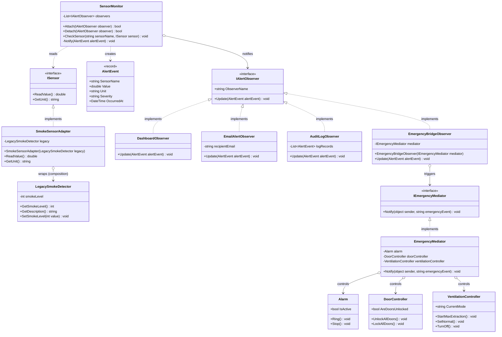

# BÁO CÁO THỰC HÀNH MẪU THIẾT KẾ: CAMPUS SAFETY HUB

> **Thông tin sinh viên:**
> - **Họ và tên:** Hoàng Đình Duy
> - **Mã sinh viên:** 202418887
> - **Học phần:** Lập trình hướng đối tượng (OOP)
> - **Chủ đề:** Campus Safety Hub - Trung tâm giám sát an toàn phòng máy

---

## 1. TỔNG QUAN HỆ THỐNG VÀ DANH MỤC LỚP

Dự án mô phỏng trung tâm giám sát an toàn cho phòng máy (**Campus Safety Hub**), tích hợp cảm biến khói thế hệ cũ, phát thông báo đa kênh và điều phối các thiết bị ứng phó sự cố khẩn cấp.

Hệ thống kết hợp 3 mẫu thiết kế cốt lõi:
1. **Adapter Pattern:** Chuyển đổi giao diện và thang đo từ cảm biến khói cũ (`LegacySmokeDetector`) sang giao diện chuẩn `ISensor`.
2. **Observer Pattern:** Phát cảnh báo đa kênh bất đồng bộ từ `SensorMonitor` tới các đối tượng đăng ký (`DashboardObserver`, `EmailAlertObserver`, `AuditLogObserver`, `EmergencyBridgeObserver`).
3. **Mediator Pattern:** Điều phối tập trung các thiết bị ứng phó sự cố (`Alarm`, `DoorController`, `VentilationController`) thông qua `EmergencyMediator` nhằm triệt tiêu sự phụ thuộc chéo giữa các thiết bị.

### Danh mục các file mã nguồn:
- [ISensor.cs](file:///D:/OOP/W11/ISensor.cs): Giao diện chuẩn cho tất cả cảm biến (`ReadValue()`, `GetUnit()`).
- [LegacySmokeDetector.cs](file:///D:/OOP/W11/LegacySmokeDetector.cs): Lớp cảm biến cũ giả định không được sửa đổi mã nguồn (`0..1000`).
- [SmokeSensorAdapter.cs](file:///D:/OOP/W11/SmokeSensorAdapter.cs): Adapter chuyển đổi thang đo `0..1000` sang phần trăm `0..100%`.
- [AlertEvent.cs](file:///D:/OOP/W11/AlertEvent.cs): Bản ghi bất biến (record) chứa thông tin sự kiện cảnh báo.
- [IAlertObserver.cs](file:///D:/OOP/W11/IAlertObserver.cs): Hợp đồng nhận cảnh báo cho các Observer.
- [SensorMonitor.cs](file:///D:/OOP/W11/SensorMonitor.cs): Lớp Subject quản lý Observer, kiểm tra ngưỡng và phát thông báo.
- [DashboardObserver.cs](file:///D:/OOP/W11/DashboardObserver.cs): Observer hiển thị trạng thái lên bảng điều khiển trung tâm.
- [EmailAlertObserver.cs](file:///D:/OOP/W11/EmailAlertObserver.cs): Observer mô phỏng gửi email cảnh báo đến quản trị viên.
- [AuditLogObserver.cs](file:///D:/OOP/W11/AuditLogObserver.cs): Observer lưu vết lịch sử sự kiện an toàn vào nhật ký.
- [EmergencyBridgeObserver.cs](file:///D:/OOP/W11/EmergencyBridgeObserver.cs): Observer cầu nối nhận sự kiện cảnh báo và chuyển tiếp đến Mediator.
- [IEmergencyMediator.cs](file:///D:/OOP/W11/IEmergencyMediator.cs): Hợp đồng điều phối giữa các thiết bị an toàn.
- [EmergencyMediator.cs](file:///D:/OOP/W11/EmergencyMediator.cs): Trung gian điều phối tập trung các phản ứng khẩn cấp.
- [Alarm.cs](file:///D:/OOP/W11/Alarm.cs): Thiết bị còi hú / chuông báo động.
- [DoorController.cs](file:///D:/OOP/W11/DoorController.cs): Bộ điều khiển khóa / mở cửa thoát hiểm.
- [VentilationController.cs](file:///D:/OOP/W11/VentilationController.cs): Bộ điều khiển hệ thống thông gió và hút khói.
- [Program.cs](file:///D:/OOP/W11/Program.cs): Giao diện Console tương tác nhập tay 100% để kiểm thử toàn diện các tình huống.

---

## 2. SƠ ĐỒ LỚP VÀ QUAN HỆ KIẾN TRÚC (CLASS DIAGRAM)

---

## 4. KỊCH BẢN KIỂM THỬ TRÊN CONSOLE

Hệ thống cung cấp giao diện Console tương tác nhập tay 100%, không sử dụng dữ liệu tự động, và **tuyệt đối không in ký tự mở ngoặc hoặc đóng ngoặc** ra màn hình console.

### Kịch bản 1: Kiểm thử Adapter Pattern
- Thao tác: Chọn chức năng 1, tự nhập mức khói thiết bị cũ từ 0 đến 1000.
- Quan sát: Giá trị đọc trực tiếp từ thiết bị cũ, mô tả thiết bị, giá trị đọc qua Adapter và đơn vị trả về.

### Kịch bản 2: Kiểm thử Observer - Quản lý danh sách & Chống trùng lặp
- Thao tác: Chọn chức năng 2, thực hiện đăng ký và hủy các Observer.
- Quan sát: Khả năng ngăn chặn đăng ký trùng lặp và cập nhật danh sách động.

### Kịch bản 3: Kiểm thử Observer - Kiểm tra ngưỡng cảnh báo
- Thao tác: Chọn chức năng 3, nhập tên cảm biến và giá trị đo.
- Quan sát: Phản ứng của các Observer tương ứng với các ngưỡng: Bình thường (dưới 50%), Cảnh báo WARNING (từ 50% đến dưới 70%), và Nguy cấp CRITICAL (từ 70% trở lên).

### Kịch bản 4: Kiểm thử Mediator Pattern
- Thao tác: Chọn chức năng 4, gửi sự kiện `FIRE_DETECTED` hoặc `ALL_CLEAR`.
- Quan sát: Sự phối hợp đồng bộ giữa chuông báo động, hệ thống cửa và quạt thông gió.

### Kịch bản 5: Kiểm thử Tích hợp toàn hệ thống Campus Safety Hub
- Thao tác: Chọn chức năng 5, nhập tên phòng và mức khói đo được.
- Quan sát: Luồng xử lý end-to-end từ cảm biến cũ qua Adapter, đến Subject SensorMonitor, phát tới các Observer và chuyển tiếp tới Mediator điều phối thiết bị.

---

